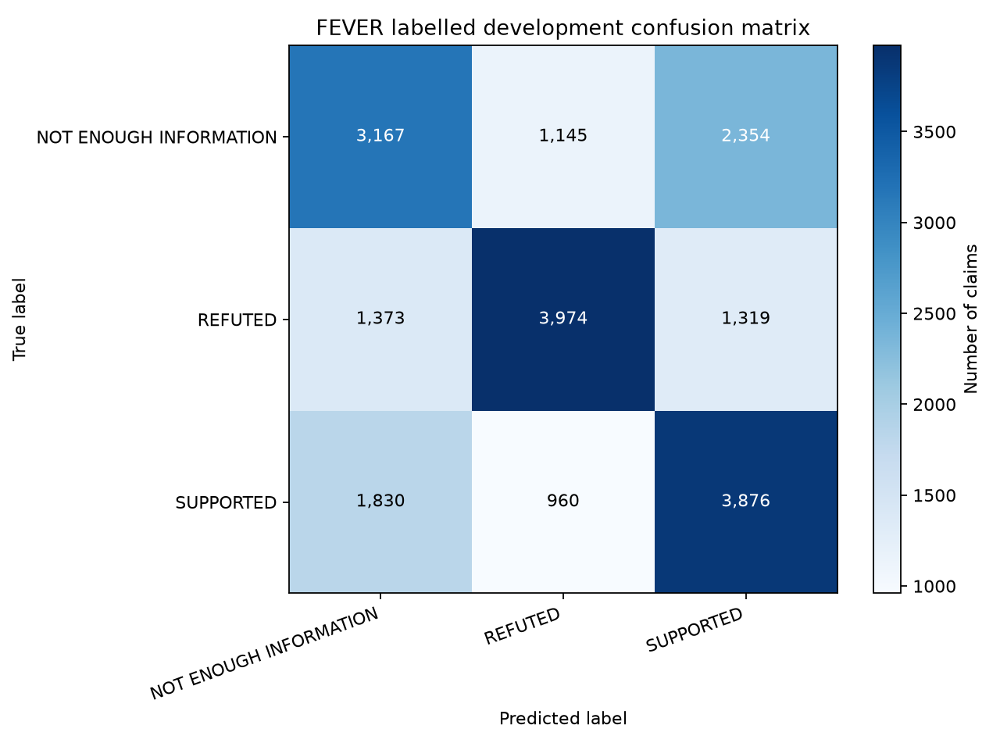
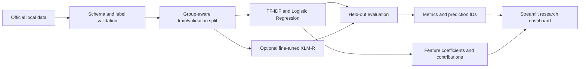

# Multilingual Misinformation Detection with Explainable AI

**Evaluating model reliability across low-resource African languages**

This repository is a reproducible research project about classifying annotated claims, measuring where a model succeeds or fails, and explaining the scores it produces. Its primary target is AfrIFact, whose published scope includes English, Yoruba, Hausa, Igbo, and other African languages. AfrIFact files require accepting access conditions on Hugging Face. Until that access is granted, the only runnable benchmark here is a separately identified, English-only FEVER experiment.

> A predicted dataset label is not an independently verified fact. The current FEVER model uses the claim text alone. It does not retrieve sources, inspect evidence passages, or decide whether a real-world claim is true.

## Current status

| Capability | Status |
|---|---|
| Dataset investigation | AfrIFact, X-Fact, and FEVER documented with their task, language, access, and license differences |
| FEVER data | 145,449 source train rows and 19,998 labelled development rows inspected locally; three overlapping normalized groups removed from training |
| TF-IDF baseline | Trained; word and character n-gram candidates selected on a seeded, stratified, duplicate-grouped validation split; final model evaluated on labelled FEVER dev |
| African-language experiments | Pending AfrIFact access and schema inspection; no target-language result is claimed |
| XLM-RoBERTa | Configurable fine-tuning pipeline; no fine-tuned model is bundled or represented as trained |
| Explainability | Fitted Logistic Regression coefficients and local feature contributions; optional Integrated Gradients implementation for a fine-tuned XLM-R model |
| Dashboard | Nine Streamlit pages; data and model status are read from local run artifacts |

Measured results are summarized in [Experimental results](#15-experimental-results) and stored in `results/fever/latest/metrics.json`. The research report is [docs/research-report.md](docs/research-report.md). No English result is treated as evidence of African-language performance.

## 1. Project overview

The project asks what a model learns when it predicts a fact-checking dataset label from a claim. It compares a traditional TF-IDF + Logistic Regression baseline with a task-fine-tuned XLM-RoBERTa model, analyzes performance by class and language, and inspects model-faithful explanations and errors.

The research questions are:

1. How does TF-IDF + Logistic Regression compare with a fine-tuned multilingual transformer on the same evaluation set?
2. How does performance differ across English, Yoruba, Hausa, and Igbo when sample sizes and dataset domains are shown?
3. Does supplied evidence improve classification when its provenance and split are valid?
4. Which words or tokens affect model scores, and do explanations expose shortcuts?
5. How well does training transfer across languages after preventing duplicate or translation leakage?
6. What can supported held-out errors tell us about model and dataset limitations?

Only questions supported by the data will be answered. Some questions remain pending until AfrIFact access and suitable evidence/text fields are available.

## 2. Background and motivation

Misinformation is difficult to classify from wording alone. A claim can be expressed indirectly, refer to a changing event, depend on context, or require specialist knowledge. A text classifier may notice correlations between a label and names, topics, writing style, or annotation practices. Such a correlation can predict a benchmark label without establishing the claim's truth.

Multilingual NLP adds another challenge. Training examples, tokenization quality, spelling conventions, and domain coverage are uneven across languages. A multilingual model can still perform poorly for a language or topic that is weakly represented in its training data. The word “low-resource” describes gaps in available data and tooling; it does not describe the speakers or the language as deficient.

Yoruba, Hausa, and Igbo are important here because they are target languages in a setting where robust fact-checking resources are less available than for English. This project measures coverage and errors rather than assuming why a score differs. Sample size, topic, translation, annotation, and source domain can all confound a language comparison.

## 3. Machine-learning fundamentals

Supervised learning uses examples with input features and target labels. Here, the input is a claim and the target is a dataset annotation. The training partition estimates model parameters; validation data helps select settings; the final held-out partition estimates performance after choices are complete.

For example, a model may learn a weight for the word “invented” that raises the score for one class in FEVER. That weight describes what the trained model found useful in those examples. It does not mean that claims containing “invented” are false in the world.

The project keeps training, validation, and held-out evaluation distinct. Text preprocessing is inside a scikit-learn `Pipeline`, so the vocabulary and inverse-document frequencies are fitted on training claims only. Duplicate normalized claims are assigned to one split. Where a dataset provides a verified parallel-claim group, the AfrIFact adapter can use it to keep translations together as well.

## 4. NLP fundamentals

Natural Language Processing converts text into representations a model can use. A traditional model needs numeric features; this project uses TF-IDF vectors of word or character n-grams. A transformer tokenizer instead maps text to subword token IDs that the pretrained encoder was built to process.

Unicode normalization uses NFC and whitespace cleanup. Diacritics are preserved: the project does not ASCII-fold Yoruba or apply English stemming/stop-word rules across all languages. Character n-grams provide a useful traditional comparison when word forms, spelling, or token boundaries vary, but they do not solve language coverage or semantic understanding.

## 5. Dataset investigation

### AfrIFact: primary target dataset

[AfrIFact's dataset card](https://huggingface.co/datasets/masakhane/AfrIFact) describes a benchmark for information retrieval, evidence extraction, and fact-checking in ten African languages and English. The card lists CC BY 4.0 and requires users to accept access conditions before accessing files. Its published Health distribution reports 848 examples per language for English, Yoruba, Hausa, and Igbo, among other languages. Those are source-published counts, not locally inspected split counts.

The adapter does not assume claim, label, evidence, language, configuration, or split field names. After access approval, inspect them with:

```bash
uv sync --extra afrifact
hf auth login
uv run python scripts/inspect_afrifact.py
uv run python scripts/inspect_afrifact.py --configuration '<verified configuration>'
```

Copy `configs/datasets/afrifact-columns.template.json` to the ignored local file `configs/datasets/afrifact.local.json`, then replace every placeholder with a field name verified from the authorized dataset. Include `group_id` only if the dataset has a verified parallel-claim identifier. Configure the true split and configuration names in `configs/transformer.toml`. The loader fails on unknown labels or missing fields rather than guessing.

### X-Fact: secondary context

[X-Fact](https://huggingface.co/datasets/utahnlp/x-fact) is a multilingual real-world claim benchmark with retrieved evidence-document fields and 25 languages. Its card lists 31,189 claims, including train/dev/test, OOD, and zero-shot partitions. The published train and zero-shot language inventories do not list English, Yoruba, Hausa, or Igbo, so it is not the selected source for the target-language experiment. Its labels and evidence semantics remain dataset-specific and are not merged into AfrIFact labels.

### FEVER: separate English baseline

[FEVER](https://fever.ai/dataset/fever.html) contains English claims annotated as `SUPPORTS`, `REFUTES`, or `NOT ENOUGH INFO`. Its official JSONL rows include `id`, `label`, `claim`, and evidence annotations. These annotations point to Wikipedia page and sentence identifiers; the downloaded files do not contain the evidence passage text. The project therefore trains claim-only classification and does not describe the run as evidence-based.

FEVER claims were generated by altering Wikipedia sentences. This makes FEVER a practical baseline and software integration source, but limits how well it represents current claims encountered in the wild. The source site describes 185,445 claims. This project uses the official training file and the labelled development file for final held-out evaluation; the blind test file is unlabelled and is not used to report metrics.

### Licensing and attribution

Code in this folder is MIT licensed. Dataset licenses and terms are separate: follow AfrIFact's CC BY 4.0 attribution/access conditions, X-Fact's card and any source-material terms, and FEVER's applicable Wikipedia/CC BY-SA terms. Raw datasets and claim text are kept local and are not committed.

The detailed source comparison is [docs/dataset-investigation.md](docs/dataset-investigation.md). It distinguishes published metadata from counts computed by this local run.

## 6. Data preprocessing

The record adapter in `ml/data/schemas.py` keeps a stable sample ID, dataset/config identifier, original source label, canonical task label, source split, language, optional evidence, and duplicate group. It does not discard provenance when mapping labels.

For FEVER, the verified mapping is:

| Original label | Internal label |
|---|---|
| `SUPPORTS` | `SUPPORTED` |
| `REFUTES` | `REFUTED` |
| `NOT ENOUGH INFO` | `NOT_ENOUGH_INFORMATION` |

These names describe the dataset annotation. `REFUTED` means the supplied benchmark annotation says its evidence refutes the claim; it is not a universal statement about truth. Unknown labels stop the run.

`ml/data/preprocessing.py` applies Unicode NFC and normalizes whitespace. `ml/data/validation.py` rejects missing IDs, empty claims, missing labels, duplicate IDs, and overlapping groups between splits. The baseline removes exact normalized claim groups that overlap the official FEVER training and labelled development files from training while keeping the held-out development file intact. The removed count is recorded in run metadata.

To inspect locally downloaded FEVER data and write aggregate-only statistics:

```bash
uv run python scripts/prepare_data.py --dataset fever
```

The output includes actual local label/language counts, character lengths, exact duplicate groups, source overlap removed, evidence annotation presence, and whether passage text is present. FEVER's downloaded annotations have no textual evidence passages, which is why evidence ablation is not run.

## 7. TF-IDF explained

TF-IDF stands for term frequency–inverse document frequency. Term frequency measures how much a term appears in a claim. Inverse document frequency reduces the weight of terms that appear in many claims. Informally, a word common to every example is less useful than a word that distinguishes some examples.

The vectorizer can emit word n-grams (single words and adjacent pairs) or character n-grams. The baseline compares word unigrams/bigrams with character spans of length 3–5. `max_features` and `min_df` keep the vocabulary bounded and remove terms that occur too rarely. `strip_accents=None` preserves meaningful marks.

The vocabulary and IDF table are learned by `TfidfVectorizer.fit` only during pipeline fitting. At validation and prediction time, the same fitted vectorizer transforms text without relearning from it. This prevents a common form of preprocessing leakage.

## 8. Logistic Regression explained

Despite its name, Logistic Regression is a classifier. It learns a weight for each feature and class. For class `k`, a linear score is approximately:

```text
score(k, claim) = intercept(k) + sum(feature_value(j) * coefficient(k, j))
```

The feature values are TF-IDF weights. For the multiclass model, the scores are normalized into class probabilities with softmax. Regularization controls how large the weights can grow; `C` sets the inverse regularization strength. The candidates use balanced class weights, which adjust the training loss to account for the FEVER class distribution.

This model is a useful baseline because it trains quickly, runs without a GPU, and exposes its learned coefficients. Its probabilities are not post-hoc calibrated. The run reports multiclass Brier score and ten-bin top-label expected calibration error as diagnostics; neither guarantees reliable confidence outside the evaluated distribution.

## 9. Transformers explained

A transformer uses self-attention layers to build contextual representations of tokens. Unlike a bag of weighted n-grams, it can represent how a token relates to the surrounding sequence. It also requires substantially more compute and is less directly interpretable than a linear classifier.

The project has a complete optional fine-tuning script. It loads a task-specific classification head, tokenizes the selected claim/evidence input, trains with validation, checkpoints, applies early stopping, saves the best model, and evaluates a separately held-out test split. No model is downloaded or fine-tuned when the Streamlit app starts.

## 10. XLM-RoBERTa explained

[XLM-RoBERTa Base](https://huggingface.co/FacebookAI/xlm-roberta-base) is a pretrained multilingual encoder. Pretraining teaches it to model text representations from large multilingual corpora; it does not teach the model the project's support/refute/insufficient-information labels. A task-specific head must be fine-tuned on labeled claims before the result can be used for this classification task.

The transformer configuration records model ID, learning rate, batch size, gradient accumulation, epochs, maximum token length, weight decay, seed, checkpoint path, and validation settings. The script chooses CUDA, Apple MPS, or CPU when available. On a small dataset CPU can still be slow. The baseline remains usable without a trained transformer.

## 11. Training workflow

The FEVER baseline workflow is:

1. Download the official files with `scripts/download_fever.py`.
2. Validate source fields, label mapping, counts, evidence availability, and overlap with `scripts/prepare_data.py`.
3. Make a seeded, approximately stratified validation fold grouped by normalized claim.
4. Compare word and character TF-IDF configurations on validation macro F1.
5. Refit the selected pipeline on the full cleaned official training partition.
6. Evaluate once on the official labelled development partition.
7. Save the local model, metadata, compact metrics, and local prediction IDs/probabilities.

Only the model binary and prediction rows containing source IDs/labels/probabilities are local artifacts. Aggregate metrics and provenance can be committed. Raw claim text is never written into the predictions file.

The transformer script uses the same group-aware validation principle, preserves an official held-out split, and saves training metadata. AfrIFact is gated, so that run cannot be completed until access is approved and exact schema/configuration settings are verified.

## 12. Model evaluation

The metrics module reports:

- **Accuracy:** fraction of all examples classified correctly.
- **Precision:** among items assigned a class, fraction that belong to it.
- **Recall:** among items belonging to a class, fraction recovered.
- **F1:** harmonic mean of precision and recall.
- **Macro F1:** F1 averaged equally across classes.
- **Weighted F1:** F1 averaged by class support.
- **Confusion matrix:** counts of each true/predicted class pair.
- **Brier score:** mean squared difference between multiclass probabilities and one-hot labels.
- **Top-label ECE:** weighted confidence/accuracy gap across ten confidence bins.

Macro F1 is useful when class counts differ because each class contributes equally. Accuracy may hide weak minority-class results. Per-language metrics are shown only when actual language metadata is present; no examples for a language means “not evaluated,” not a score of zero.

The FEVER official labelled development set is the held-out evaluation partition for this baseline. The official blind test is not used. Metrics cannot be compared to transformer scores unless those scores use the same dataset version, task fields, and held-out examples.

## 13. Multilingual and cross-lingual experiments

AfrIFact is the intended source for the four target languages. Once authorized, run language-specific metrics with sample counts, preserve native text, and inspect its parallel-claim structure. If a trusted group ID exists, pass it through the optional `group_id` mapping so translations cannot split across train and evaluation. If no such ID is available, exact normalized duplicate protection does not detect all translations; document that limitation.

X-Fact is not used to claim target-language coverage. Its published language list does not match the four targets. FEVER only provides English data in this project. Therefore, until AfrIFact access and evaluation exist, cross-lingual transfer and language-specific performance are pending.

Language score differences do not by themselves establish inherent bias or a causal effect of language. Topic, source, translation, sample size, annotation, and label balance require analysis.

## 14. Explainable AI

For Logistic Regression, global explanations show the largest positive and negative class coefficients. Local explanations multiply each active TF-IDF value by its fitted coefficient for the selected class score. The contributions sum with the intercept to that class's linear score. This is an explanation of the model computation, not a proof that a feature causes a belief or that the claim is true.

For an available fine-tuned XLM-R model, `ml/explainability/transformer_explanations.py` implements Captum Integrated Gradients over token embeddings with a zero-embedding baseline. It attributes a selected class logit to subword tokens. The method is model-specific, and choices such as baseline and aggregation affect the result. Token attribution does not establish causal reasoning or factual correctness.

Explanations may disagree across methods. They can expose suspicious reliance on names, labels, or topic words, but an explanation cannot establish fairness or reliability by itself. The dashboard labels the class score and method and states these limits.

## 15. Experimental results

### FEVER baseline

The measured values below are English-only and correspond to the official labelled development file, after removing three duplicate normalized claim groups (three rows) from training. The word unigram/bigram candidate was selected on validation macro F1. The character 3–5-gram configuration is retained as a validation comparison, not as another final test run.

| Metric | Measured result |
|---|---:|
| Test examples | 19,998 |
| Accuracy | 0.5509 |
| Macro F1 | 0.5516 |
| Weighted F1 | 0.5516 |
| Multiclass Brier score | 0.5686 |
| Top-label ECE (10 bins) | 0.1083 |

The labelled development set has 6,666 examples for each class. Per-class results:

| Label | Precision | Recall | F1 |
|---|---:|---:|---:|
| NOT_ENOUGH_INFORMATION | 0.4972 | 0.4751 | 0.4859 |
| REFUTED | 0.6537 | 0.5962 | 0.6236 |
| SUPPORTED | 0.5134 | 0.5815 | 0.5453 |

The confusion matrix uses rows as true labels and columns as predicted labels in the order `NOT_ENOUGH_INFORMATION`, `REFUTED`, `SUPPORTED`:

| True \ Predicted | NOT_ENOUGH_INFORMATION | REFUTED | SUPPORTED |
|---|---:|---:|---:|
| NOT_ENOUGH_INFORMATION | 3,167 | 1,145 | 2,354 |
| REFUTED | 1,373 | 3,974 | 1,319 |
| SUPPORTED | 1,830 | 960 | 3,876 |



On the internal validation fold, word unigrams/bigrams achieved macro F1 0.5814 and character 3–5-grams achieved 0.5683. The selected model's final fit took 12.60 seconds; prediction across the held-out 19,998 claims took 0.186 seconds on Python 3.14.6 and an arm64 Mac. These are one-run timings, not a hardware benchmark.

The equal class supports explain why macro and weighted F1 are the same here. The weakest class F1 is NOT ENOUGH INFORMATION (0.4859); the confusion matrix shows frequent confusion with the two evidence-bearing labels. This is a benchmark observation, not a manual error-category or causal analysis. The Brier score and ECE are uncalibrated probability diagnostics and should not be read as proof of confidence reliability.

Per-class scores, confusion matrix, candidate validation scores, training time, inference time, package versions, source file checksums, and split details are stored in the machine-readable result and model metadata. The compact metric file is the recorded output of `scripts/run_baseline.py`; prediction rows and the model remain local.

### AfrIFact and XLM-R

African-language metrics, evidence ablation, cross-lingual transfer, and a direct baseline/transformer comparison are pending. No transformer has been fine-tuned in this repository yet. The pretrained XLM-R checkpoint is not presented as a trained classifier.

## 16. Error analysis

The error-analysis page reads local held-out prediction rows and joins claim text only from the user's local FEVER development file. It displays the true and predicted dataset labels. It does not assign unsupported categories such as “cultural error” or “negation error” automatically.

For a research paper, manually inspect a documented sample of failures, record the selection method, preserve source IDs, and assign a category only when the example supports it. Useful hypotheses include negation, entity confusion, lexical shortcuts, ambiguity, evidence mismatch, translation variation, and unsupported domains. These are categories to investigate, not findings from this run unless explicitly annotated.

## 17. System architecture



Dataset loading, preprocessing, training, evaluation, and explainability live under `ml/`; Streamlit is a presentation layer under `app/`. Training scripts are separate from app startup. Raw data and binaries stay local, while compact aggregate metrics and docs are versioned.

## 18. Complete code walkthrough

| Path | Responsibility |
|---|---|
| `ml/data/schemas.py` | Canonical record with original label and dataset/split provenance |
| `ml/data/loaders.py` | Strict FEVER JSONL and explicitly mapped, authorized Hugging Face loading |
| `ml/data/preprocessing.py` | NFC/whitespace normalization and deterministic duplicate keys |
| `ml/data/splits.py` | Stratified, group-aware train/validation indices |
| `ml/data/validation.py` | Required-field, duplicate-ID, and cross-split checks |
| `ml/data/statistics.py` | Aggregate statistics from data that was actually loaded |
| `ml/models/baseline.py` | TF-IDF + Logistic Regression pipeline and inference helper |
| `ml/models/transformer.py` | Optional device selection and local fine-tuned model loading |
| `ml/evaluation/metrics.py` | Classification, per-language, entropy, Brier, and ECE metrics |
| `ml/explainability/linear_explanations.py` | Coefficients and local linear score contributions |
| `ml/explainability/transformer_explanations.py` | Optional token attribution via Integrated Gradients |
| `scripts/download_fever.py` | Official FEVER downloads with schema validation and atomic writes |
| `scripts/prepare_data.py` | Data validation and aggregate-only source summary |
| `scripts/run_baseline.py` | Validation selection, final refit, held-out metrics, local model |
| `scripts/run_transformer.py` | Configurable XLM-R fine-tuning for inspected data/splits |
| `scripts/evaluate_models.py` | Recomputes stored FEVER aggregate metrics from prediction rows |
| `scripts/inspect_afrifact.py` | Displays accessible configurations/features without bypassing access controls |

## 19. Streamlit application walkthrough

Launch from this folder with `uv run streamlit run app/main.py`. The app uses `st.navigation` and `st.Page` to provide:

1. Research overview and actual run status.
2. English FEVER claim-only classification when a trained model exists.
3. Validation candidates and held-out metrics/confusion matrix.
4. Language scores only when the run includes language metadata.
5. Global coefficients and local explanations.
6. Held-out error inspection from local files.
7. Dataset count, label, language, duplicate, and evidence availability summaries.
8. Research methodology and dataset investigation.
9. Project scope, references, and ethical limits.

Missing models, data, metrics, and transformer checkpoints produce explicit empty states. User claim input is limited to 2,000 characters. Text is rendered as ordinary text and is never treated as HTML, a command, or a request to call another service. The app does not train models or download gated data on startup.

## 20. Installation

Python 3.11–3.14 is supported by the project metadata. A local environment uses [`uv`](https://docs.astral.sh/uv/):

```bash
cd multilingual-misinformation-xai
uv sync --extra dev
```

To get the English baseline data and train:

```bash
uv run python scripts/download_fever.py
uv run python scripts/prepare_data.py --dataset fever
uv run python scripts/run_baseline.py --config configs/baseline.toml
```

The official train and labelled dev files are downloaded from links on the [FEVER dataset site](https://fever.ai/dataset/fever.html). They are stored in ignored `data/raw/` and are not committed.

Install the authorized AfrIFact adapter only after accepting dataset access conditions:

```bash
uv sync --extra afrifact
hf auth login
uv run python scripts/inspect_afrifact.py
```

For transformer training, install the optional stack:

```bash
uv sync --extra transformer --extra explainability
uv run python scripts/run_transformer.py --config configs/transformer.toml --columns configs/datasets/afrifact.local.json
```

Fill the TOML configuration and local JSON mapping only with actual source names obtained after access. The script rejects missing configuration/split names and unknown feature names.

## 21. Reproducing experiments

Run the baseline from the project root:

```bash
uv run python scripts/download_fever.py
uv run python scripts/prepare_data.py --dataset fever
uv run python scripts/run_baseline.py --config configs/baseline.toml
uv run python scripts/evaluate_models.py --run results/fever/latest
uv run python scripts/generate_figures.py
```

The run writes a compressed joblib model under ignored `artifacts/models/`, compact metrics and metadata under `results/fever/latest/`, and ID/label/probability prediction rows that remain ignored. Metadata records the UTC timestamp, dataset file SHA-256 hashes, label mapping, seed, split strategy, library/runtime versions, hardware platform, and measured time. Exact bit-for-bit reproduction can still vary across library versions, numerical kernels, and hardware; the lock file and recorded metadata make those differences inspectable.

Other commands:

```bash
uv run pytest
uv run ruff check .
uv run streamlit run app/main.py
```

## 22. Deployment

The baseline app can run locally without a GPU. Do not include raw FEVER data, gated AfrIFact data, Hugging Face tokens, or large model binaries in a public deployment. A baseline-only deployment should include an authorized baseline artifact and aggregate metrics, or clearly show the missing-model state. Transformer inference is optional and a fine-tuned model must be supplied as a local artifact; the app will not fetch it automatically.

## 23. Ethical considerations

Automated labels can harm people when treated as authoritative. Dataset annotations reflect a benchmark's definitions and evidence process. They are not universal truth labels and should not be used alone for moderation, reputation scoring, or decisions about people.

Language coverage and performance must be reported with data counts, domain information, and uncertainty. A higher aggregate score can hide a failure for a language or class. Error examples and explanation outputs should be handled under dataset privacy and license terms. Do not publicly display restricted samples.

## 24. Limitations

- The current result is English FEVER only; it says nothing about Yoruba, Hausa, or Igbo performance.
- AfrIFact access is gated, and actual split/feature schemas remain to be inspected by an authorized user.
- X-Fact's documented language inventory does not include the target languages.
- FEVER labels are generated in an edited-Wikipedia benchmark process, not live fact-checking.
- The downloaded FEVER JSONL includes evidence annotations but not evidence passage text; no evidence-conditioned score is reported.
- Claim-only models can learn topic/entity shortcuts and cannot retrieve or assess sources.
- Exact-text duplicate grouping does not identify translated claims unless a verified parallel group field is available.
- Linear probabilities are not post-hoc calibrated; Brier/ECE are distribution-specific diagnostics.
- Captum Integrated Gradients code is optional and has not been run without an available fine-tuned transformer artifact.
- No manual error-category study, fairness audit, or causal analysis is claimed.

More detail is in [docs/limitations.md](docs/limitations.md).

## 25. Future research

1. Obtain and document authorized AfrIFact configuration and feature metadata.
2. Inspect language, label, topic, annotation provenance, official splits, and parallel-claim groups.
3. Train a shared-split baseline and XLM-R model; compare only identical examples and tasks.
4. Report per-language and per-class metrics with sample counts and uncertainty intervals.
5. Run claim-only/evidence ablation only if actual evidence passages are available and source-verified.
6. Manually categorize a preregistered sample of errors.
7. Evaluate calibration on a separate validation split and robustness to spelling/domain shift.
8. Investigate retrieval as a separate system component rather than attributing retrieval quality to the classifier.

## 26. Academic relevance

### EMLDS

This project gives a concrete way to discuss text representation, Unicode, tokenization, language metadata, corpus provenance, cross-lingual transfer, annotation, evaluation, and the limits of generalizing from an English benchmark.

### EMILDAI

It also surfaces legal and governance questions: dataset access conditions, licensing, attribution, automated decision limits, explanation reliability, unequal language coverage, and the difference between a model prediction and an evidence-supported judgment. It does not imply endorsement by Erasmus Mundus or either program.

## 27. Interview preparation

### 30-second explanation

“I built a reproducible research pipeline for studying claim-label classification and model reliability across African languages. It uses an interpretable TF-IDF/Logistic Regression baseline, an optional XLM-R fine-tuning pipeline, group-aware evaluation, feature explanations, and a Streamlit research dashboard. I deliberately separate an English-only FEVER baseline from the intended AfrIFact experiments because the AfrIFact files require access approval; I do not claim multilingual results I have not measured.”

### Two-minute technical explanation

“The data layer preserves original labels, language, split, IDs, and optional evidence. For FEVER, I map the three source classes to canonical names and remove exact normalized claim groups that overlap train and labelled development. A stratified group split creates validation data from the official train set. I compare word and character TF-IDF configurations on validation macro F1, refit the winner on the full cleaned train set, and evaluate on the labelled development partition. The pipeline exposes class coefficients and local score contributions. The dashboard shows provenance and the fact that this is claim-only classification. AfrIFact is the target multilingual benchmark, but the data is gated, so its schema and performance remain pending.”

### Interview questions and short answers

1. **Why is this not a fake-news detector?** It predicts benchmark labels; it does not retrieve evidence or establish truth.
2. **Why use macro F1?** It weighs each class equally and can reveal weak minority-class performance that accuracy hides.
3. **What does TF-IDF do?** It weights terms by their frequency in one text and rarity across the training collection.
4. **Why Logistic Regression?** It is a fast, strong baseline with class probabilities and directly inspectable coefficients.
5. **What does C control?** It is inverse regularization strength; higher C allows larger weights and can overfit.
6. **What is data leakage here?** Information from held-out text or labels influencing fitting/model selection; the vectorizer fits only training data.
7. **Why group duplicates?** Similar or identical claims across partitions make test scores optimistic; groups stay together.
8. **Why use FEVER if the target is African languages?** It validates the software and baseline as a clearly separate English experiment, not as a substitute for AfrIFact.
9. **Why is AfrIFact access important?** It is the intended source for the target languages and includes evidence-oriented tasks; the repository requires accepting conditions.
10. **Why not train on X-Fact?** Its published training/zero-shot language inventory does not cover the four target languages and its labels are dataset-specific.
11. **Does a high probability mean the claim is true?** No; it is a model output associated with training labels and may be uncalibrated.
12. **What is calibration?** Agreement between predicted confidence and observed correctness frequency over examples.
13. **What is Brier score?** A proper probability error measure based on squared differences from one-hot labels; lower is better.
14. **What do local coefficients explain?** The feature contributions to a selected linear class score for that input.
15. **Are explanations causal?** No. They describe model computation and association, not causes or truth.
16. **Why character n-grams?** They can capture subword patterns and spelling variation without relying on exact whitespace token boundaries.
17. **What is cross-lingual transfer?** Applying a model trained on one language/group to another language, evaluated on genuinely held-out examples.
18. **How do you prevent translation leakage?** Use a verified shared group ID if the dataset provides one; exact-text normalization alone cannot identify every translation.
19. **Why XLM-R?** It is a pretrained multilingual encoder that can be fine-tuned for a text classification task.
20. **Is the base XLM-R model a classifier?** No. It needs a classification head fine-tuned on labeled task examples.
21. **Why separate evidence retrieval and classification?** Retrieval finds candidate source text; verification assesses a claim against it. Their errors and metrics differ.
22. **Why preserve original labels?** It keeps source semantics auditable when internal names are normalized.
23. **What is a limitation of FEVER?** Its claims were constructed from Wikipedia sentences and differ from naturally occurring current claims.
24. **What would you do when AfrIFact access is approved?** Inspect exact configs, fields, splits, labels, evidence provenance, and parallel IDs before defining experiments.
25. **How do you avoid unsupported language claims?** Show data coverage and counts and mark unavailable languages as not evaluated.

## 28. References

- [AfrIFact dataset card](https://huggingface.co/datasets/masakhane/AfrIFact) and [EMNLP paper](https://aclanthology.org/2026.emnlp-main.133/).
- Gupta, A. and Srikumar, V. (2021). [X-FACT: A New Benchmark Dataset for Multilingual Fact Checking](https://aclanthology.org/2021.acl-short.86/). ACL.
- Thorne, J. et al. (2018). [FEVER: a Large-scale Dataset for Fact Extraction and VERification](https://aclanthology.org/N18-1074/). NAACL-HLT.
- Conneau, A. et al. (2020). [Unsupervised Cross-lingual Representation Learning at Scale](https://aclanthology.org/2020.acl-main.747/). ACL.
- [XLM-RoBERTa Base model card](https://huggingface.co/FacebookAI/xlm-roberta-base).
- [Streamlit `st.Page` and `st.navigation` documentation](https://docs.streamlit.io/develop/api-reference/navigation/st.page).

## 29. Glossary

| Term | Meaning in this project |
|---|---|
| Annotation | A label assigned by dataset annotators under a dataset's rules |
| Claim-only | Classification using claim text without evidence passage input |
| Evidence-based verification | Predicting support/refutation/insufficient information from a claim and supplied evidence |
| Feature | A numeric input to a traditional model, such as an n-gram TF-IDF weight |
| Fine-tuning | Updating a pretrained model on labeled examples for a particular task |
| Held-out set | Data reserved for final evaluation, not model selection |
| Macro F1 | Mean class F1 with equal weight per class |
| N-gram | A contiguous sequence of n words or characters |
| Parallel claim | The same semantic claim represented in multiple languages |
| Probability calibration | Agreement between stated confidence and empirical correctness frequencies |
| Split leakage | Shared examples/groups or fitted information crossing train and evaluation boundaries |
| TF-IDF | Term frequency multiplied by inverse document frequency weighting |
| XLM-R | XLM-RoBERTa, a pretrained multilingual text encoder |

## 30. Learning roadmap

1. Read the task distinction and dataset investigation before interpreting any score.
2. Trace one FEVER row through `load_fever_jsonl`, canonical label mapping, and `ClaimRecord`.
3. Follow `grouped_train_validation_indices` and verify why the same group cannot be in both splits.
4. Fit the baseline on a tiny fixture and inspect the TF-IDF matrix shape and feature names.
5. Work through one local explanation and check that contributions plus intercept match the model class score.
6. Reproduce the official FEVER run and read its label counts, metrics, confusion matrix, and metadata.
7. Use the Streamlit pages to compare aggregate results and inspect local failures only from local data.
8. Read the XLM-R pipeline and identify every setting that consumes compute or changes the experiment.
9. After authorized AfrIFact access, inspect the real schema before adapting config; do not skip the provenance checks.
10. Write down which research question each experiment answers and which questions remain unsupported.

The goal is to understand what each pipeline step does and what it cannot establish, not simply to quote a model score.
