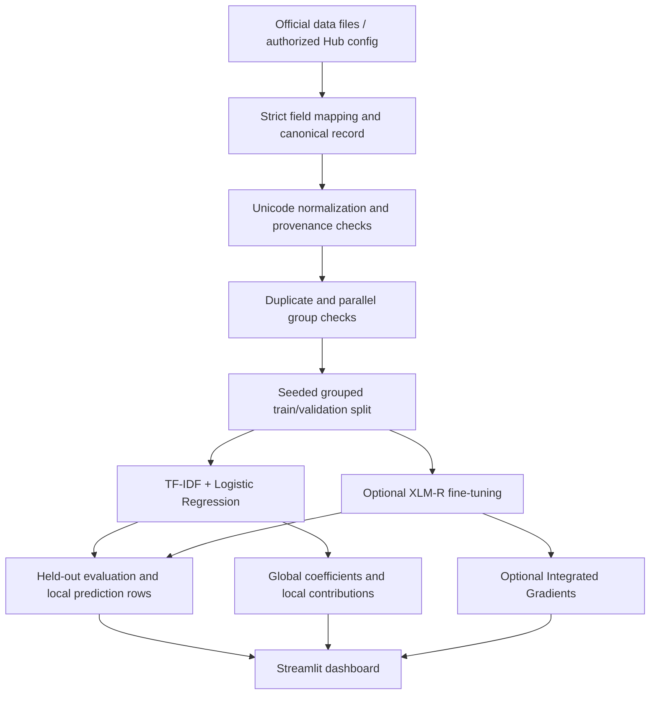

# Architecture

## Runtime boundaries

- Dataset and ML modules do not import Streamlit.
- Training scripts run only when explicitly invoked; dashboard startup never trains.
- The baseline dashboard uses local joblib and aggregate JSON artifacts.
- Prediction rows keep source IDs and labels but omit raw claim text. Error-analysis pages join text only from the user's local source data.
- AfrIFact loading requires an explicit verified configuration and mapping; missing authorization produces an actionable error.
- The transformer loader uses `local_files_only=True` in the app, so an absent fine-tuned artifact does not trigger model downloads.

## Artifact policy

Raw data, processed data, model/checkpoint binaries, secrets, and per-example prediction outputs remain local via `.gitignore`. Aggregate metrics, configurations, dataset investigation, model metadata, and static figures can be committed after ensuring they do not contain raw samples or restricted content.
